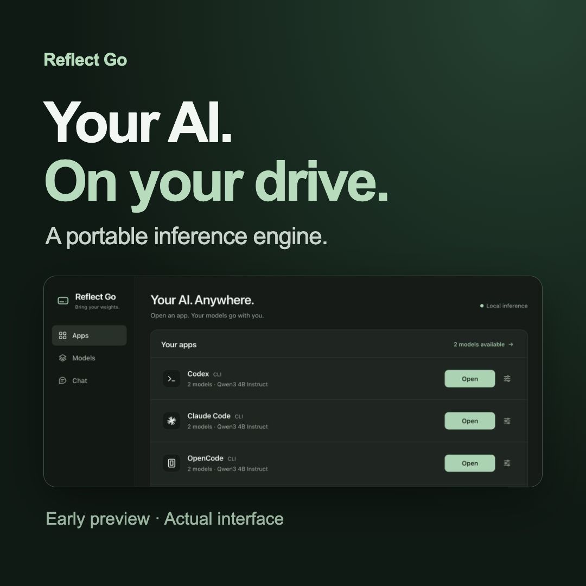

# Reflect Go

**Your weights. Your way.** Carry your AI models and the software to run them on
an external drive. Open Reflect Go on a compatible computer, choose your app,
and work with your local model.

**[Download Reflect Go](https://github.com/odomcl22/reflect-go/releases/tag/v0.4.9-preview)** ·
[Watch the walkthrough](docs/media/reflect-go-walkthrough.mp4) ·
[App compatibility](docs/HARNESS_COMPATIBILITY.md)

Reflect Go includes a local inference engine, preconfigured portable coding
clients, a model library, and built-in chat. Your drive holds the model weights;
the computer provides the processing power and memory. Once your models and
software are downloaded, local inference works offline without a cloud AI
subscription or a separate engine installation.

*Walkthrough from an earlier preview. Version 0.4.9 updates the model finder and download layout.*

## Download

Choose **Reflect Go** to bring your own models, or **Starter Pack** to download
the app with Gemma and Muse ready to use. No build tools are required.

- **Reflect Go** includes the application, inference runtimes, and portable Codex
  and OpenCode CLI clients. Add your own model or download one in the app.
- **Reflect Go Starter Pack** includes the same software with **Gemma 4 31B
  Instruct QAT Q4_0** and **Muse Glimmer 30B Q4_K_M**. It targets compatible
  computers with 48 GiB or more memory; models load one at a time.

| Platform | Reflect Go | Reflect Go Starter Pack |
| --- | --- | --- |
| Mac · Apple Silicon + Intel | [Download ZIP](https://github.com/odomcl22/reflect-go/releases/download/v0.4.9-preview/ReflectGo-0.4.9-macos.zip) | [Download ZIP](https://github.com/odomcl22/reflect-go/releases/download/v0.4.9-preview/ReflectGo-StarterPack-0.4.9-macos.zip) |
| Windows · x64 + ARM64 | [Download ZIP](https://github.com/odomcl22/reflect-go/releases/download/v0.4.9-preview/ReflectGo-0.4.9-windows.zip) | [Download ZIP](https://github.com/odomcl22/reflect-go/releases/download/v0.4.9-preview/ReflectGo-StarterPack-0.4.9-windows.zip) |
| Linux · x64 + ARM64 | [Download ZIP](https://github.com/odomcl22/reflect-go/releases/download/v0.4.9-preview/ReflectGo-0.4.9-linux.zip) | [Download ZIP](https://github.com/odomcl22/reflect-go/releases/download/v0.4.9-preview/ReflectGo-StarterPack-0.4.9-linux.zip) |

**Version: 0.4.9 preview.** Mac downloads are signed and Apple-notarized.
Windows executables are unsigned and may show a SmartScreen warning. Testing on
physical Windows and Linux computers is still in progress. See
[release notes and checksums](https://github.com/odomcl22/reflect-go/releases/tag/v0.4.9-preview)
and [testing status](docs/PREVIEW_0_4_9_VALIDATION.md).

The Starter Pack transfers about **34.4 GB of weights**, plus the app. Its small
ZIP contains a download helper that retrieves and verifies all preselected pack
files from this release, then assembles the ready-to-run folder. GitHub's per-file
limit requires model parts; you do not need to select or download models inside
the app afterward. Allow **60 GB free space** during preparation and use a drive
that supports files over 4 GB (such as exFAT or APFS, rather than FAT32).
[Starter Pack instructions](docs/PREVIEW_0_4_9.md).

The extracted app folder has just **one launcher** and **Reflect Go Files**.
Runtimes, clients, models, settings, and documentation stay inside the support
folder. Source code stays here on GitHub.

## Get started

1. **Extract the entire ZIP** into a new folder on your external drive or computer.
   Keep the launcher beside **Reflect Go Files**.
2. **Open Reflect Go:**
   - **Mac:** open `Reflect Go.app` (macOS 13.3 or later).
   - **Windows:** open `Reflect Go.exe`.
   - **Linux:** open `Reflect Go.desktop`; your desktop may require **Allow Launching**.
     A terminal fallback is `sh "Reflect Go Files/Reflect Go.sh"`.
3. **Add a model** in **Models → Add models**, or use one of the Starter Pack’s
   included models. For a small chat test, IBM Granite 4.0 1B is an optional download.
4. **Open your coding client.** Reflect Go starts the local service automatically
   and supplies your saved model choices. Choosing a project folder or changing
   which models are available is optional.

For coding and desktop apps, choose a compatible model with enough context and
memory for the task. The large Starter Pack models have verified download
checksums; 48/128 GiB hardware performance and desktop tool use are still being
qualified. Their metadata-based memory profiles support CLI and desktop contexts; actual
large-host inference and desktop tool use still require qualification. Model size
alone does not establish compatibility.
[Read the setup guide](docs/PREVIEW_0_4_9.md).

## Choose your app

Use **Codex CLI** or **OpenCode CLI** directly from the included portable clients.
Reflect Go configures their local connection and keeps their profiles on the drive.
For **Claude Code**, click **Get Claude Code** once. Reflect Go downloads the
pinned native client directly from Anthropic, verifies it, and keeps it on your
drive. No separate Python or Node installation is needed. Claude's proprietary
binary is not redistributed in the public ZIP. [Client setup](docs/PORTABLE_CLIS.md).

Already use a desktop app? Preview connections are available for **Claude
Desktop**, **Codex mode in ChatGPT Desktop**, and **OpenCode Desktop**. These
require the desktop app to be installed on your computer. Each app has its own
model and platform requirements, and full desktop coding workflows are still
being tested. [Check compatibility](docs/HARNESS_COMPATIBILITY.md) before connecting.

You can also use Reflect Go's built-in **Chat** or launch **OpenCode Web**.
Additional connections are under **More apps**.

## Bring your models

Search the **Reflect Go catalog** in **Models → Add models**, or import your own
compatible single-file GGUF. The catalog includes pinned Hugging Face downloads;
it is not a live Hugging Face search. Filter by developer, download size, or
memory estimate, and check each model’s source and license.

Download a catalog model or import a compatible GGUF file. Reflect
Go uses llama.cpp and recommends models and settings based on your computer.
Model architecture, available memory, and context size determine what can run.

Choose which models to offer each supported client and set a default. Reflect Go
remembers those choices and loads models as they are requested. Offering several
models does not mean they all need to be loaded into memory at once.

Appearance and runtime controls are in **Settings**, including **Dark**, **Light**,
and **System** themes.

## Finish and take it with you

Finish your work and exit portable CLI sessions, then **Quit Reflect Go** before
ejecting the drive. For connected desktop apps, **Disconnect** or **Quit** restores
the settings Reflect Go changed and restarts the apps with their previous
configuration. You do not need to sign out of your accounts.

Clients can access the project folders you authorize. Installed desktop apps and
the operating system may keep their own files on the computer. If a connection
cannot be restored automatically, Reflect Go reports the issue;
[the setup guide](docs/PREVIEW_0_4_9.md#disconnect-without-signing-out) explains recovery.

## About the project

Reflect Go is in active development. Explore the [roadmap](docs/ROADMAP.md),
[compatibility details](docs/HARNESS_COMPATIBILITY.md), and
[validation report](docs/PREVIEW_0_4_9_VALIDATION.md), or
[report an issue](https://github.com/odomcl22/reflect-go/issues).

Developers can find the application code in [Sources](Sources), build and
packaging tools in [scripts](scripts), and design notes, earlier phase plans, and
release documentation in [docs](docs). Previous source versions are preserved in
the repository's commit history.
