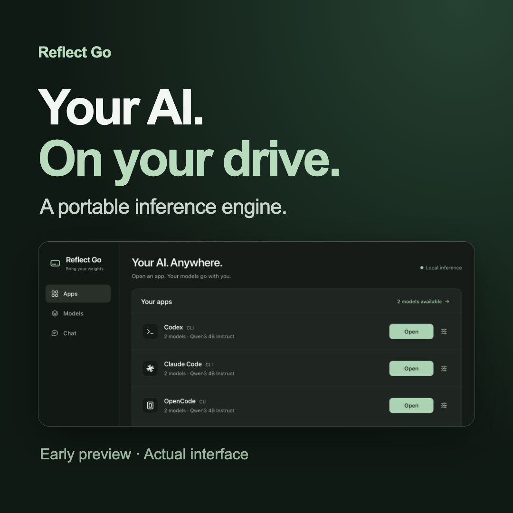
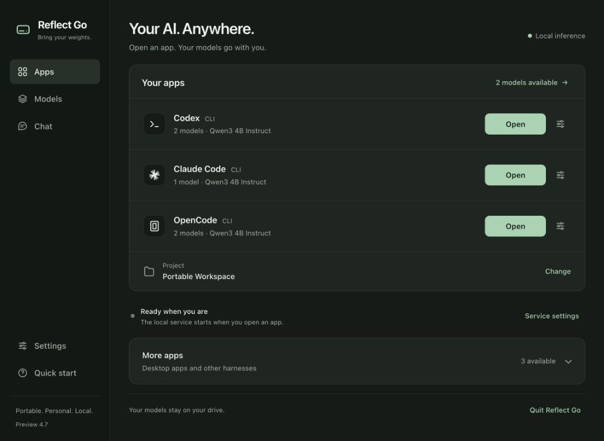

# Reflect Go

**Your weights. Your way.** Reflect Go carries local AI models and the software
to run them on a drive. Open it on a compatible computer, choose a supported
client, and work with your local model.

[](docs/media/reflect-go-walkthrough.mp4)

▶ [Watch the 24-second walkthrough](docs/media/reflect-go-walkthrough.mp4)
— real interface captures, with captions and no sound. This shows the launch
workflow; it is not an end-to-end inference demonstration.
[Watch the original brand intro](docs/media/reflect-go-intro.mp4) (12 seconds, with sound).

**Early preview · [Download compiled apps](https://github.com/odomcl22/reflect-go/releases/tag/v0.4.8-preview) · No build tools needed.**

The drive stores model weights, launcher, inference runtime, libraries, and
settings. The attached computer supplies CPU, GPU, and RAM. Once the drive is
prepared, local inference needs no cloud AI subscription or separate engine
installation on that computer. Clients can access the project folders you give
them permission to use. See [app compatibility](docs/HARNESS_COMPATIBILITY.md)
for tested integrations and platform limitations.

**Current preview: 0.4.8. Open Reflect Go → open your app → work.**
Reflect Go starts the local service automatically and supplies remembered models.
Choosing a project folder or changing offered models is optional. Codex, Claude
Code and OpenCode CLI have individual model selections and defaults.

Extract the entire download, then open **Reflect Go.app** on Mac,
**START Reflect Go.exe** on Windows, or run `sh "Reflect Go.sh"` on Linux.
Keep the app/exe beside its support folders. On the personal drive, use **Phase 4.8**.
See [startup and features](docs/PREVIEW_0_4_8.md),
[validation](docs/PREVIEW_0_4_8_VALIDATION.md), and
[app compatibility](docs/HARNESS_COMPATIBILITY.md).
The current execution-tested host is an Apple M1 Mac. Other platform builds
require physical qualification. Earlier previews remain preserved.

| Edition | Included |
| --- | --- |
| Reflect Go | Application, supported inference runtimes and portable clients with local configuration. Bring, download or import your own model. |
| Reflect Go Starter Pack | Everything above plus one small demonstration model for testing setup and chat. |

**No Plus tier.** The personal package includes Codex, Claude Code and OpenCode.
Shareable packaging excludes proprietary Claude binaries pending a permitted
distribution method. Installed Claude Desktop connects separately.

| Download | Reflect Go (bring your model) | Starter Pack (one chat demo model) |
| --- | --- | --- |
| Mac · Apple Silicon + Intel | [Download ZIP](https://github.com/odomcl22/reflect-go/releases/download/v0.4.8-preview/ReflectGo-0.4.8-macos.zip) | [Download ZIP](https://github.com/odomcl22/reflect-go/releases/download/v0.4.8-preview/ReflectGo-StarterPack-0.4.8-macos.zip) |
| Windows · x64 + ARM64 | [Download ZIP](https://github.com/odomcl22/reflect-go/releases/download/v0.4.8-preview/ReflectGo-0.4.8-windows.zip) | [Download ZIP](https://github.com/odomcl22/reflect-go/releases/download/v0.4.8-preview/ReflectGo-StarterPack-0.4.8-windows.zip) |
| Linux · x64 + ARM64 | [Download ZIP](https://github.com/odomcl22/reflect-go/releases/download/v0.4.8-preview/ReflectGo-0.4.8-linux.zip) | [Download ZIP](https://github.com/odomcl22/reflect-go/releases/download/v0.4.8-preview/ReflectGo-StarterPack-0.4.8-linux.zip) |

Mac downloads are Developer ID signed and Apple-notarized. Windows preview executables are unsigned and may trigger SmartScreen. Physical Windows/Linux qualification remains pending. The starter model demonstrates simple chat; desktop clients need a larger-context model. [Checksums and release notes](https://github.com/odomcl22/reflect-go/releases/tag/v0.4.8-preview).

Graphical connections now include **Claude Desktop**, **Codex in ChatGPT Desktop**
and **OpenCode Desktop** preview adapters, alongside **OpenCode Web** and an installed
**DeepSeek Harness**. Quit restores connected desktop profiles and restarts those apps;
you do not need to sign out. Antigravity remains a research target.
Availability and actual qualification are stated separately in the compatibility
report. The engine carries local weights; a desktop app may remain installed on
the host.

The home screen keeps the three client launchers and an optional project together.
Model choices live in **Models**, appearance and runtime controls in **Settings**,
and additional harnesses under **More apps**.



## Source repository

This repository contains application source, build and download scripts, pinned
artifact metadata, tests, and documentation. Compiled distributions live in [GitHub Releases](https://github.com/odomcl22/reflect-go/releases/tag/v0.4.8-preview);
model weights, bundled third-party clients and backup archives are not committed to source.
Generated packages belong in `dist/` and private backups in `releases/` locally.

Runtime profiles, credentials, raw conversation logs and `docs/evidence/` are
excluded from Git. Historical validation documents refer to evidence retained
locally; those raw files are intentionally absent from this repository. The
separate website checkout and its draft history are also excluded. Preserve
upstream license notices when assembling a distribution.

## Agreed next milestones

See the [roadmap to 1.0](docs/ROADMAP.md) for the updated client-first workflow,
model catalogs and on-demand loading, in-app model downloads, automatic setting
recommendations, understandable failures, and simple chat with appearance controls.
It also defines the **Reflect Go** and **Reflect Go Starter Pack** editions.
The current implementation is in 0.4.8; acceptance gates and deferred work
remain in the roadmap. Phase 4.5 instructions below describe that preserved preview.

The core path is **3.1 workstation hardening → 4.0 supported Windows/Mac/Linux runtime → 4.5 CLI compatibility and portable harness packs → Reflect Go 1.0 qualification**. The initial harness targets are **Codex CLI, OpenCode CLI, and Claude Code CLI**, all using the shared local model provider. Phase 4.5 carries pinned native harness software with isolated profiles on the drive; a host installation is an explicit command-line alternative.

The three portable CLIs are the core; graphical adapters are qualified individually. Phase 4.5 includes all three in the personal working copy; its archive excludes proprietary Claude binaries and all client state. Physical device qualification and broader model/workflow testing remain. Network orchestration and distributed inference are deferred separate work. See [the agreed North Star scope](docs/NORTH_STAR.md#agreed-product-scope--2026-10-04).

ChromeOS/Chromebooks are a conditional Phase 4 target through an enabled Linux development environment. Device policy, drive execution permissions, memory, and available acceleration require physical qualification; zero setup on every Chromebook is not promised.

## Preserved development phases and shared models

Public downloads contain only the current package. For the personal development collection in `dist/Reflect Go`, keep these siblings together:

```text
Reflect Go/
  Models/       One copy of each model, shared across phases
  Phase 1/      Local chat demonstration
  Phase 2/      Local provider and existing-client connectors
  Phase 3/      Original workstation release
  Phase 3.1/    Hardened Mac workstation
  Phase 4/      Adaptive Windows, Mac and Linux runtime; native Mac/browser UI
  Phase 4.5/    Preserved portable CLI preview
  Phase 4.6/    Preserved gateway, downloads, recommendations, chat and themes
  Phase 4.7/    App-first launch, remembered selections and graphical adapters
  Phase 4.8/    Desktop context, reversible connections and native app icons
  Workspace/    Default client workspace; separate from models and software
```

Phase 4 adds software for six operating-system/architecture combinations and multiple backends; it is larger than the earlier Mac-only phases. The two shared models still occupy about 3.4 GiB total, with no new weight copies. Archive phase software without archiving its models. Removing a model from `Models/` makes it unavailable to every phase using it; restore that file to use it again. The old `dist/PortableAI` build and assembly download cache are separate historical/development artifacts, not part of this collection.

The project’s top-level `releases/` is the only backup archive location. Phase archives include source and compiled software, never model weights or runtime state. No backup Releases folder is needed in `dist/Reflect Go` or on the USB. Working Phase 1 now has shared model paths, Reflect Go branding, and a system prompt describing local execution. Its original source and binaries remain recoverable.

<details>
<summary>Historical previews and phase instructions</summary>

## Phase 4.5: preserved portable CLI preview

Open **START Reflect Go.exe** on Windows or **Reflect Go.app** on Mac. Linux uses
`sh "Reflect Go.sh"`. Start the engine with the 4B model and 16,384 context when
eligible, choose a project outside the collection, and open one of the three
portable CLIs. Finish the client, stop the engine, quit the workstation, then eject.
Double-clicking the Windows executable again reopens the existing browser session.
Advanced Windows command launchers are grouped in `Advanced/`.

See the Phase 4.5 README for platform prerequisites, profile isolation, personal
Claude packaging, troubleshooting and exact test steps. `scripts/prepare_harnesses.py`
and `scripts/prepare_harness_helpers.py` install pinned artifacts during assembly;
`scripts/build_phase45.py` compiles the front ends into a fresh Phase 4.5 copy.
The packaged application performs no automatic harness downloads at launch.

## Phase 4: preserved adaptive runtime

Open `Phase 4/Reflect Go.app` on Mac, `Reflect Go.cmd` on Windows, or run
`sh "Reflect Go.sh"` from the Phase 4 folder on Linux. Windows/Linux open your
existing browser. Select a model, start the engine and try a quick response.
Keep the browser launcher's terminal open; use **Quit workstation** before ejecting.
The native Mac app continues to offer the same controls as Phase 3.1.

Auto selects Metal on Mac, probes Vulkan on supported Windows/Linux systems and
falls back to CPU. The Windows CPU build is self-contained; the optional Windows
Vulkan build requires existing GPU drivers and MSVC runtime libraries. Linux
bundles GCC/OpenMP/OpenSSL libraries and requires glibc 2.38+ (see each pack's
exact audit). ChromeOS support is conditional through its Linux environment.

Run **Verify Portability** to save a real load, authentication, streaming,
generation and shutdown report in `state/qualification.json` on another host.
Built packages are not a claim that every platform has been physically tested.
Codex and Claude CLI adapters use existing installations; portable packs and
OpenCode are included in the newer Phase 4.5 personal build.

Build from source on this Mac with `python3 scripts/build_windows_runtime.py`
followed by `python3 scripts/build_phase4.py`. The scripts pin and checksum
build-time downloads, cross-compile native launchers, inspect runtime dependencies,
and refuse to replace an existing Phase 4 folder. Go/LLVM-MinGW stay in `.build`;
they are not host runtime requirements. macOS Xcode command-line tools, Python,
CMake and Ninja are build requirements.

## Phase 3.1: preserved Mac workstation

1. Open **Phase 3.1 → Reflect Go.app**. The **Reflect Go.command** shortcut opens the same app. If macOS asks for access to the removable drive, allow it so Reflect Go can read the models and save its settings.
2. Choose a model and click **Start engine**. Wait for **Engine ready**. The app loads the model and keeps the portable inference engine running.
3. Choose a separate project folder, then click **Open Codex** or **Open Claude**. Your client opens in its own Terminal window and uses this local model. Codex asks for one task; Claude starts its interactive interface.
4. If Claude asks to use the API key supplied by Reflect Go, choose **Yes**, even if its default says **No (recommended)**. This approves the local provider key passed by the connector. Normal project/tool permission prompts still apply. The exact wording can vary with Claude Code versions.
5. Quit the client, click **Stop & unload**, and quit Reflect Go before ejecting the drive.

The **Quick start** tab explains this inside the app. If a first-open drive check times out, finish any macOS access prompt and click **Refresh**. **Diagnostics** shows engine errors, a safe-to-copy status report, and a file-integrity check. **Try a quick response** generates a real short answer so you can confirm inference before opening a client. Model speed appears after generation; it is read from the runtime’s average throughput metric. Engine memory is measured resident memory, which may exclude some GPU allocations. The Mac memory reading is active + wired + compressed memory, not a free-memory guarantee.

Settings include context, automatic Metal or CPU compute, temperature, CPU threads, and port. Stop the engine to change them. Preferences travel in `Phase 3.1/state/workstation.json`. Add compatible GGUFs to **Models**, then refresh the app. The 4B model is the coding default when it fits; the smaller model is a lighter chat demonstration. Lower context can prevent coding clients from fitting their prompts.

Phase 3 uses port **8766** by default; Phase 2 uses **8765**. The app owns only the engine it starts and does not stop other phases. Avoid keeping several models loaded if your Mac runs short of memory. A port conflict appears in Diagnostics. Normal window close/quit offers to stop the engine. Phase 3.1 adds a supervisor that stops its child after app crash/force quit (about ten seconds maximum under normal OS scheduling). This protection applies to engines launched by the app, not separately launched provider terminals. Quit normally before ejecting.

The app and inference runtime travel together with the drive. Existing Codex CLI or Claude Code installations are needed for the client buttons. Common installation locations (`~/.local/bin`, `/opt/homebrew/bin`, `/usr/local/bin`) are detected; the `.command` connectors also remain available. No host account configuration is changed. This release supports the tested CLI clients, not their desktop apps.

Phase 3.1 keeps your model selected when context changes, warns when it no longer fits, times out startup after five minutes, and retains one previous engine log in `state/workstation-previous.log`. A simultaneous second app cannot replace the active session log. Corrupt saved run settings produce a notice and restore defaults. Diagnostics checks have bounded runtimes.

See `docs/PHASE_3_1_VALIDATION.md` for Phase 3.1 checks and `docs/PHASE_3_VALIDATION.md` for the original workstation measurements. Claude’s supplied-key approval is documented in its [authentication guide](https://code.claude.com/docs/en/authentication).

## Phase 1: local chat

Open **Phase 1 → Reflect Go.command**, choose the 1.5B model, and wait for `>` before typing. Ctrl-D at an empty prompt quits; Ctrl-C interrupts generation, and a second Ctrl-C exits. Wait for completion before ejecting.

The original runtime treats **Return on an empty message as permission to generate a continuation**. This can produce unrelated text before a normal user turn. Avoid submitting an empty message. The reported exam-question stream is consistent with that behavior, although the exact original keystroke sequence has not been reproduced. Local system instructions improve deployment context but cannot guarantee truthful answers.

For measured speed and loading details, launch `./Reflect\ Go.command chat --verbose` in Terminal, or use a one-shot request:

```sh
./PortableAI.command run --verbose --prompt 'Explain a bicycle gear in two sentences.'
./PortableAI.command run --cpu --prompt 'Write a friendly reminder.'
./PortableAI.command doctor
./PortableAI.command models
./PortableAI.command verify
```

Verbose diagnostics can include prompt text. Context is finite; the runtime rejects overflow rather than silently expanding memory use.

## Phase 2: experimental local provider

1. Open **Phase 2 → Start Provider.command**. Wait for `listening on http://127.0.0.1:8765`.
2. Keep that provider terminal open. In a **second terminal**, start with **Connect Codex.command**. Enter the full path of a separate project folder. **Connect Claude.command** is experimental.
3. If Claude asks whether to use the supplied API key, choose **Yes** for the Reflect Go local connection. Use the client to work on that project. The provider terminal reports actual tokens per second after responses.
4. Quit the client, press Ctrl-C in the provider terminal, and wait for completion before ejecting.

Connectors require an **existing client installation**. They do not install clients or change account/provider configuration. The inference runtime travels with the drive. Codex Desktop and Claude Desktop are not validated by these CLI tests.

Codex runs one entered task through `codex exec`, with its workspace-write sandbox and no approval escalation. It uses a short general coding prompt for the smaller local model; it still owns the agent loop, shell tools, and edits. Claude Code opens its terminal interface with manual permissions, minimal startup, and built-in coding tools. Both select only the loopback provider; no cloud fallback is configured. Client-owned logs/state may remain on the host. Claude receives short general recovery guidance, but repeat tests still showed failed edits; its connector is experimental.

Start with a small test project. Both clients encountered repeated edit failures in some trials. The final Codex profile completed the USB fixture successfully; coding quality is still limited by the model. The provider defaults to Qwen3-4B-Instruct-2507 Q4_K_M and **16,384 tokens of context**. A successful repair proves the integration can perform work; it does not establish broad coding reliability. Use one client at a time: concurrent clients on the single inference slot can repeatedly discard each other's prompt cache. Claude Code may display its own assumed context size or estimated dollar cost; these are not measurements of this local provider or cloud charges.

See `docs/PHASE_2_VALIDATION.md` in the source project for acceptance results and limitations.

## Provider configuration

`config/portableai.json` controls chat context, temperature, shared models, provider context, and default provider model. `--context`, `--model`, `--cpu`, and `--port` override a launch:

```sh
./Start\ Provider.command --port 8766
./Start\ Provider.command --context 8192 --cpu
```

Connectors read the instance's connection settings automatically. Reducing context can make client prompts too large. The provider binds **only to 127.0.0.1**, creates a random bearer key in `state/provider-key`, and has no built-in file/shell agent or web UI. Routes include `/v1/chat/completions`, `/v1/responses`, and `/v1/messages`; compatibility is limited to tested workflows, not every cloud feature. `/metrics` exposes runtime measurements. Client tools execute in the client.

Do not publish the key. exFAT does not enforce Unix private-file permissions; anyone who can read the drive can read it. No LAN listener, persistent service, administrator operation, or runtime model download is installed.

## Memory, integrity, and portability

The memory screen reserves half the Mac's physical RAM. It estimates weights, working buffers, and context cache from bounded GGUF metadata for supported dense architectures, with a conservative fallback. It **does not measure free memory or guarantee fit**. Close memory-heavy apps if loading fails. One model is loaded per provider process. Apple Neural Engine is not used.

Place compatible single-file text GGUFs directly in `Models/`. Split files and multimodal projectors are unsupported. The runtime must support an added model's architecture. Packaged models are checksum-verified before launch; `verify` checks packaged software and the phase's pinned model. Added models and editable configuration are outside the manifest. A manifest detects changes; it is not publisher authentication.

Inference HOME, caches, and temporary files live under the phase's `state/`. macOS-managed swap, caches, logs, and terminal scrollback can remain on the host. Paths are relative, so the drive can be renamed.

Run **VerifyPortability.command** on the drive to record hardware, check hashes, and perform inference with networking denied. Repeat on a second compatible Mac without installing an inference stack. That remains an open acceptance check.

This engineering release is not Developer ID signed or notarized. The native app has an ad-hoc signature for structural integrity. Use normal macOS security approval where appropriate; the launcher does not change quarantine or security policy. Managed Macs or no-exec volumes may prevent execution. The 13.3 deployment floor is not proof every newer OS has been tested.

## Assemble on a development Mac

Assembly requires Xcode command line tools, Python 3.9+, and internet access for pinned artifacts. No third-party Python packages are required.

```sh
python3 scripts/build.py --phase 1 --output 'dist/Reflect Go/Phase 1' --shared-models 'dist/Reflect Go/Models'
python3 scripts/build.py --phase 2 --output 'dist/Reflect Go/Phase 2' --shared-models 'dist/Reflect Go/Models'
python3 scripts/build.py --phase 3.1 --output 'dist/Reflect Go/Phase 3.1' --shared-models 'dist/Reflect Go/Models'
python3 tests/test_bundle.py 'dist/Reflect Go/Phase 1'
```

The builder refuses to overwrite a destination. Choose fresh directories for new builds. It verifies pinned runtime/model downloads, audits native ARM64 dependencies, copies required dylibs as ordinary files for exFAT, and packages licenses. `--shared-models` must name sibling `Models`. Omit it for a standalone phase containing its own `models/`.

See the North Star, architecture decisions, and validation reports in `docs/`. Windows, Linux, Intel Macs, and conditional Chromebook support belong to Phase 4 qualification. Networking between machines and distributed inference remain deferred separate work.

To preserve a release, use `python3 scripts/archive_release.py --phase 3.1 --label phase-3-1-YYYY-MM-DD`. It refuses overwrite and writes only to the project’s `releases/`, excluding weights and state.

</details>
